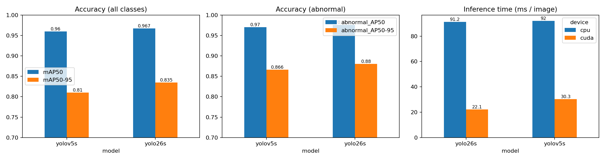

# GETCHA YOLO Upgrade

철도시설물(전차선 애자) 이상 탐지 서비스 **[GETCHA](https://github.com/Ltaerim/GETCHA)** 의 유지보수 프로젝트.
2024년 YOLOv5로 개발한 모델을 2026년 기준 최신 모델인 **YOLO26**으로 교체할 가치가 있는지 동일 조건에서 비교하고,
재실험 과정에서 발견한 데이터 · 학습 · 서버 병목을 측정하고 개선했다.

## Summary

| | YOLOv5s | YOLO26s | 차이 |
|---|---|---|---|
| Recall | 0.910 | **0.936** | +2.6%p |
| mAP50-95 | 0.810 | **0.835** | +2.5%p |
| 이상 클래스 AP50 | 0.970 | **0.976** | +0.6%p |
| GPU 추론 (평균) | 30.3 ms | **22.1 ms** | −27% |
| CPU 추론 (평균) | 92.0 ms | 91.2 ms | −1% |
| 모델 크기 | **14.3 MB** | 20.3 MB | +42% |
| 학습 시간 (30 epoch) | **132 min** | 159 min | +21% |

- **GPU 서버**: YOLO26s로 교체. 재현율과 추론 속도가 모두 개선된다.
- **CPU 서버**: 추론 속도 이득이 거의 없어 기존 모델을 유지하고, 모델 로드 방식 개선을 우선 적용한다.



## 실험 조건

- 데이터: AIHub 전차선 애자 상태 인식 데이터 (train 22,612장 / val 2,826장)
- 클래스: 정상(0), 이상(1)
- 공통 설정: imgsz 416, batch 16, epoch 30, seed 0, Colab T4 GPU
- 속도 측정: 원본 해상도 val 이미지 100장, warm-up 5회 후 end-to-end 시간 (전처리 + 추론 + 후처리)

## 재실험 중 발견한 문제

### 1. 라벨 클래스 오류
기존 라벨은 모든 객체의 클래스 번호가 1로 저장되어 있었고, 실제 정상/이상 정보는 줄 끝의 상태 텍스트에 있었다.

```
1 0.766 0.490 0.306 0.334 이상 -        # train: 이상만 텍스트 표시, 나머지는 정상
1 0.436 0.269 0.034 0.062 정상          # val: 모든 줄에 상태 텍스트
```

train에서 텍스트가 없는 줄의 비율(91.6%)이 val의 정상 비율(91.5%)과 일치해, 텍스트 유무로 0/1을 다시 매겼다.
(`scripts/prepare_data.py`)

### 2. 학습 데이터 로딩 병목
재학습 시 epoch당 약 19분이 걸렸다. 고해상도 원본 이미지를 매 epoch 드라이브에서 읽고 디코딩 · 리사이즈하는 과정이 병목이었다.

| | epoch당 시간 |
|---|---|
| 개선 전 (원본 이미지, Drive 직접 로드) | 19.2 min |
| 개선 후 (416px 사전 리사이즈 + 로컬 디스크 + RAM 캐시) | **4.4 min** |

### 3. 서버 모델 로드 병목
기존 `app.py`는 `torch.hub.load(..., force_reload=True)`로 실행할 때마다 yolov5 저장소를 새로 내려받았다.

| 단계 (CPU, 30회 평균) | 시간 |
|---|---|
| 모델 로드 (force_reload=True) | 124.2 s |
| 모델 로드 (로컬 저장소) | **0.3 s** |
| 요청 1건: decode / inference / draw / save | 12.4 / 71.3 / 0.8 / 7.6 ms |

`server/app.py`에 로컬 로드, YOLO26 선택 옵션, 요청별 결과 파일 분리를 반영했다.

## 구조

```
configs/data.yaml            데이터 설정 (prepare_data.py가 재생성)
scripts/prepare_data.py      라벨 재정의 + 이미지 사전 리사이즈
scripts/train.py             YOLOv5s / YOLO26s 동일 조건 학습 및 검증
scripts/benchmark.py         GPU / CPU 추론 속도 비교
scripts/profile_server.py    Flask 서버 단계별 시간 측정
scripts/plot_results.py      결과 그래프
server/app.py                개선된 추론 서버
notebooks/colab_experiment.ipynb   Colab 실행 노트북
results/                     실험 결과 (csv, json, png)
```

## 실행

```bash
git clone https://github.com/ultralytics/yolov5
pip install -r requirements.txt -r yolov5/requirements.txt

python scripts/prepare_data.py --root <dataset_path> --img 416
python scripts/train.py --data configs/data.yaml --project runs --epochs 30
python scripts/benchmark.py --v5 runs/v5/weights/best.pt --new runs/yolo26s/weights/best.pt --images bench_original
python scripts/profile_server.py --weights runs/v5/weights/best.pt --image bench_original/<sample>.jpg
```

서버 실행

```bash
cd server
MODEL_TYPE=yolo26 MODEL_PATH=../runs/yolo26s/weights/best.pt python app.py
```

데이터셋과 학습된 가중치는 포함하지 않는다. (AIHub 이용 약관상 재배포 불가)
